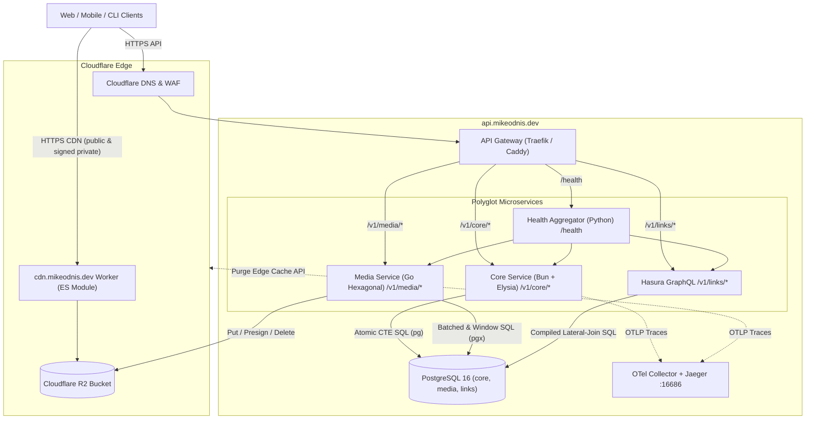
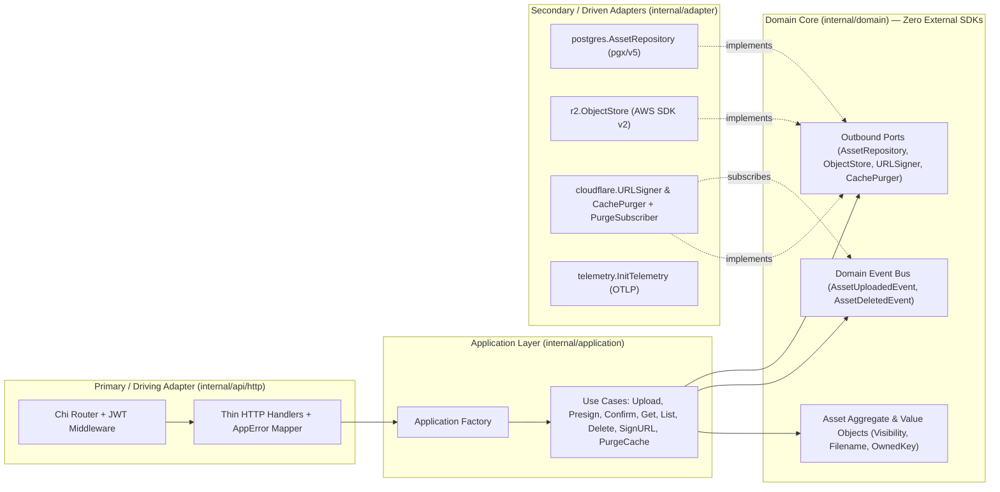
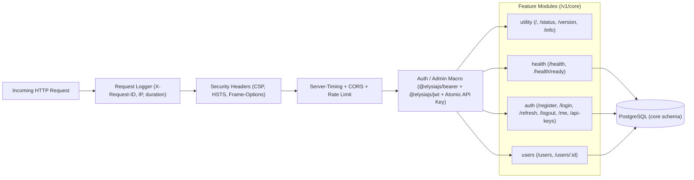
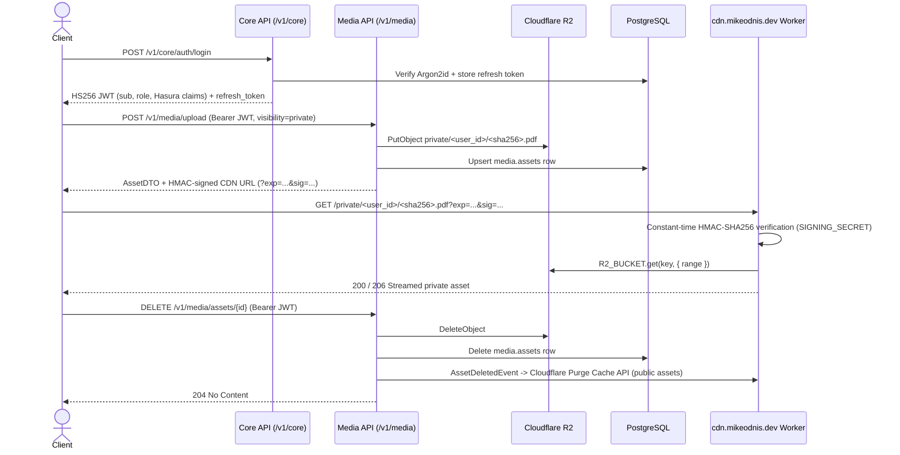
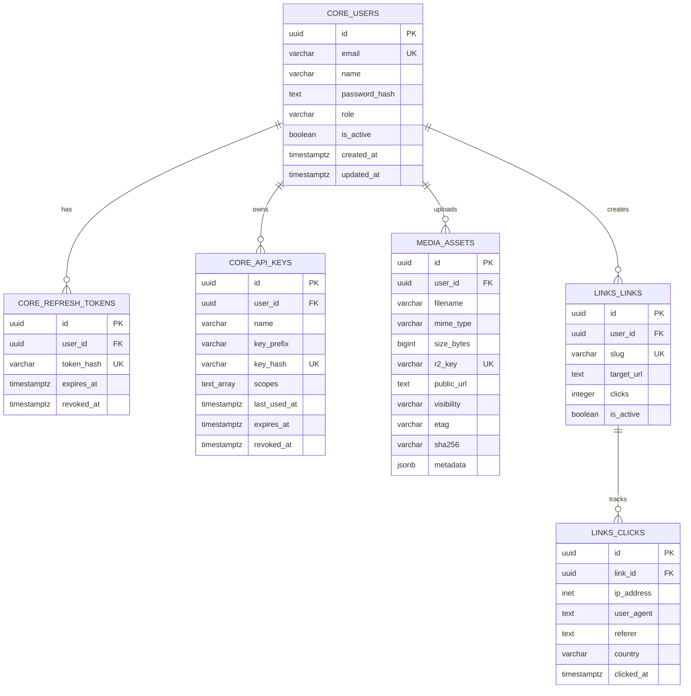

# API Infrastructure — `api.mikeodnis.dev`

Production-ready, polyglot API platform engineered to run alongside [`cdn.mikeodnis.dev`](https://github.com/WomB0ComB0/cdn).

- **Core Service (`/v1/core/*`)** — **Bun + Elysia** (feature modules, named auth/admin macros, Argon2id + HS256 JWTs with Hasura claims, rotating refresh tokens, scoped API keys, OpenAPI 3.1 + Scalar UI, Eden Treaty end-to-end type safety, Server-Timing, OpenTelemetry).
- **Media Service (`/v1/media/*`)** — **Go (Hexagonal / Ports & Adapters + DDD)** with `chi`, `pgx/v5`, Cloudflare R2 S3 SDK v2, domain events, HMAC-SHA256 private CDN URL signing, Cloudflare cache purging, and automated Go AST hexagonal boundary tests.
- **Links Service (`/v1/links/*`)** — **Hasura GraphQL Engine** with auto-applied metadata, row-level JWT permissions, and production allow-lists.
- **Health Aggregator (`/health`)** — **Zero-dependency Python 3.12** stdlib concurrent upstream probe with per-service latency reporting.
- **Edge CDN (`cdn.mikeodnis.dev`)** — **Cloudflare Worker (ES Module) + R2** serving public immutable `/assets/*`, HMAC-verified `/private/*`, and `/img/*` transforms.

---

## System Architecture



---

## Go Media Service — Hexagonal Architecture

`services/media` implements **Ports & Adapters (Hexagonal Architecture) + DDD**, inspired by [go-hexagonal](https://github.com/WomB0ComB0/go-hexagonal). Dependencies strictly point **inward** toward the domain core and are enforced automatically on every test run via Go AST inspection in [architecture_test.go](file:///home/wombocombo/github/prs/api/services/media/architecture_test.go).



---

## Core Service — Elysia Request Lifecycle & Modules

`services/core` follows official [ElysiaJS best practices](https://elysiajs.com/essential/best-practice): feature-based modules (`controller` + `service` + TypeBox `model`), named deduplicated auth/admin macros, `return status(...)` for end-to-end **Eden Treaty** + **OpenAPI 3.1** inference, and single-roundtrip atomic SQL CTEs.



---

## End-to-End Auth, Private Media & CDN Purge Flow



---

## Database Schema (N+1-Free & Indexed)

All endpoints run in **O(1)** database roundtrips using atomic CTEs (`register`, `refresh`, `api_key` auth), window functions (`COUNT(*) OVER()`), batched lookups (`WHERE id = ANY($1::uuid[])`), and composite indexes on `(user_id, created_at DESC)` and `(link_id, clicked_at DESC)`.



---

## API Endpoints

### Core Service (`/v1/core`)
| Method | Path | Auth | Description |
| :--- | :--- | :--- | :--- |
| `GET`/`HEAD` | `/v1/core`, `/status`, `/version`, `/info` | Public | Root, runtime memory/uptime, version, and metadata |
| `GET`/`HEAD` | `/v1/core/health`, `/v1/core/health/ready` | Public | Liveness & PostgreSQL readiness probes |
| `GET` | `/v1/core/docs`, `/v1/core/openapi.json` | Public | Scalar OpenAPI 3.1 UI & raw JSON specification |
| `POST` | `/v1/core/auth/register` | Public | Create account + issue JWT & refresh token (1 CTE) |
| `POST` | `/v1/core/auth/login` | Public | Verify Argon2id password + issue JWT & refresh token |
| `POST` | `/v1/core/auth/refresh` | Public | Atomically rotate refresh token (1 CTE) |
| `POST` | `/v1/core/auth/logout` | Public | Revoke refresh token |
| `GET` | `/v1/core/auth/me` | JWT / API Key | Current authenticated user profile |
| `POST`/`GET`/`DELETE` | `/v1/core/auth/api-keys`, `/api-keys/:id` | JWT | Create, list, and revoke scoped `mk_live_*` keys |
| `GET` | `/v1/core/users` | Admin JWT | Paginated user list with `total` (`COUNT(*) OVER()`) |
| `GET`/`PATCH`/`DELETE` | `/v1/core/users/:id` | Self or Admin | Read, update, or delete user |

### Media Service (`/v1/media`)
| Method | Path | Auth | Description |
| :--- | :--- | :--- | :--- |
| `GET` | `/v1/media/health`, `/health/ready`, `/openapi.json` | Public | Liveness, R2+DB readiness, OpenAPI 3.0.3 spec |
| `POST` | `/v1/media/upload` | JWT | Multipart upload to R2 (`assets/` or `private/`) + DB record |
| `POST` | `/v1/media/presign` | JWT | Direct-to-R2 15-minute presigned PUT URL |
| `POST` | `/v1/media/assets/confirm` | JWT | Verify presigned object via `HeadObject` and persist metadata |
| `POST` | `/v1/media/sign` | JWT | Generate HMAC-SHA256 signed `cdn.mikeodnis.dev/private/*` URL |
| `POST` | `/v1/media/purge` | JWT | Purge Cloudflare edge cache (owner-scoped or admin) |
| `GET` | `/v1/media/assets` | JWT | Paginated asset list with `total` (`COUNT(*) OVER()`) |
| `GET`/`DELETE` | `/v1/media/assets/:id` | Owner / Admin | Fetch metadata or delete from R2 + DB + event-driven CDN purge |

### Links Service (`/v1/links`) & Aggregate Health (`/health`)
| Method | Path | Auth | Description |
| :--- | :--- | :--- | :--- |
| `POST` | `/v1/links/v1/graphql` | Anonymous / JWT | Hasura GraphQL endpoint (allow-listed in prod) |
| `GET` | `/v1/links/healthz` | Public | Hasura health probe |
| `GET` | `/health` | Public | Concurrent aggregate health across Core, Media, and Hasura |

---

## Quick Start (Local Development)

### Prerequisites
- [Docker](https://docs.docker.com/) + Docker Compose v2
- [Bun](https://bun.sh/) 1.4+, [Go](https://go.dev/) 1.25+, Python 3.12+ (for local testing outside Docker)

```bash
# 1. Generate .env with secure random secrets (JWT_SECRET, SIGNING_SECRET, DB password)
./setup.sh

# 2. Fill in CLOUDFLARE_R2_* credentials in .env, then boot the stack
make dev

# Optional: boot with OpenTelemetry Collector + Jaeger UI (http://localhost:16686)
make dev-obs

# 3. Verify all services
make health
./scripts/test-api.sh http://localhost
```

### Running Tests Locally

```bash
# Run all service tests (Core Elysia + Eden Treaty, Go Hexagonal + AST boundary check, Python Health)
make test

# Individual suites
make test-core     # bun test && bun run typecheck
make test-media    # go vet ./... && go test -race -v ./...
make test-health   # python3 -m unittest discover -v
```

---

## End-to-End Hosting

Two complete, production-ready hosting paths are included — see [docs/DEPLOYMENT.md](file:///home/wombocombo/github/prs/api/docs/DEPLOYMENT.md) for the step-by-step runbook:

1. **Managed PaaS (Railway + Cloudflare Workers/R2)** — Zero server maintenance:
   - Each service ships with a `Dockerfile` and `railway.toml` (`services/gateway`, `services/core`, `services/media`, `services/health`, `hasura`) plus `scripts/db-init.sh` for Railway PostgreSQL.
   - `services/gateway` (Caddy) routes `api.mikeodnis.dev` across Railway private networking (`*.railway.internal`).
   - `cdn.mikeodnis.dev` deploys to Cloudflare Workers via `bunx wrangler deploy` using `wrangler.jsonc`.
2. **Single VPS (Docker Compose + Traefik + Let's Encrypt + Cloudflare Workers/R2)** — Lowest cost (~$5–$20/mo):
   - Uses `docker-compose.yml` + `docker-compose.prod.yml` with `traefik/traefik.prod.yml` for automatic HTTPS, HTTP→HTTPS redirects, and container scaling (`replicas: 2`).

---

## Documentation

- [docs/ARCHITECTURE.md](file:///home/wombocombo/github/prs/api/docs/ARCHITECTURE.md) — System design, hexagonal rules, N+1-free SQL patterns, and CDN contract
- [docs/DEPLOYMENT.md](file:///home/wombocombo/github/prs/api/docs/DEPLOYMENT.md) — Complete Railway + Cloudflare and VPS + Traefik hosting runbooks
- [docs/API.md](file:///home/wombocombo/github/prs/api/docs/API.md) — Detailed API reference
- [CONTRIBUTING.md](file:///home/wombocombo/github/prs/api/CONTRIBUTING.md) — Development workflow

---

## License

Apache License 2.0 — see [LICENSE](file:///home/wombocombo/github/prs/api/LICENSE).
