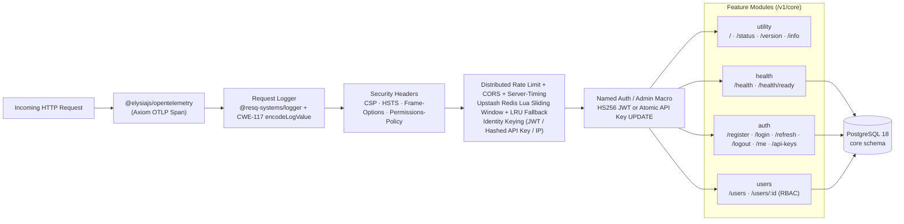
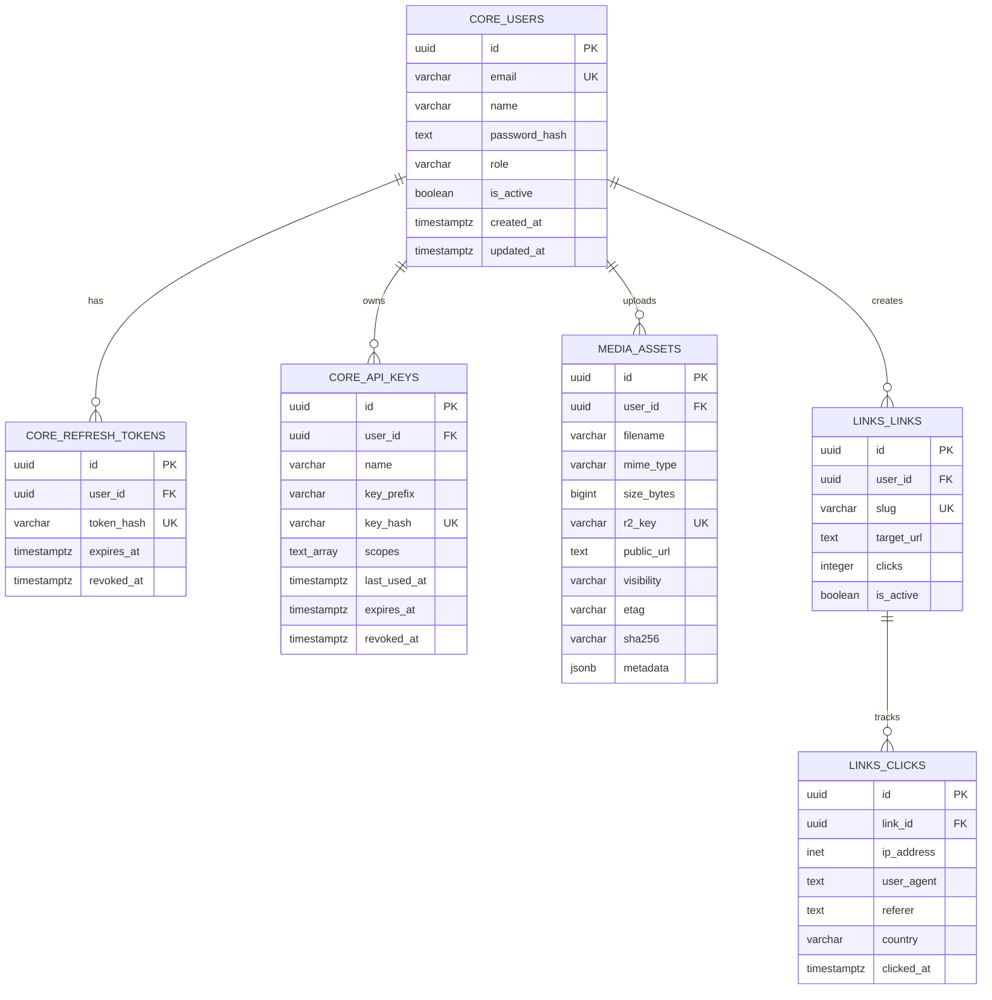
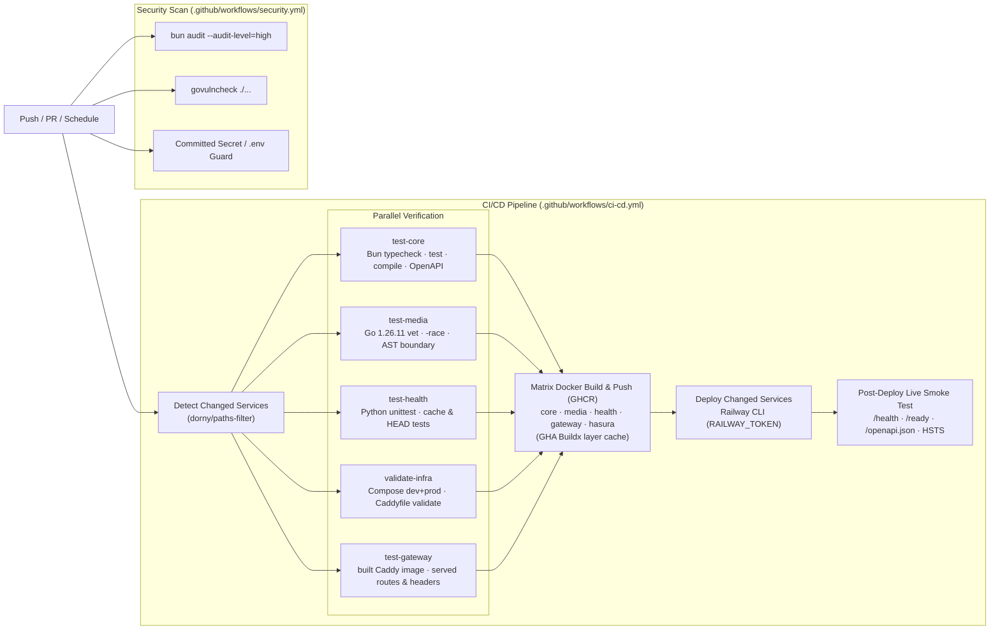

# API Infrastructure — `api.mikeodnis.dev`

[](https://github.com/WomB0ComB0/api/actions/workflows/ci-cd.yml)
[](https://status.mikeodnis.dev)
[](https://github.com/WomB0ComB0/api/releases)
[](LICENSE)

Production polyglot API platform hosted end-to-end on **Railway (US East)** alongside the Hexagonal Edge CDN [`WomB0ComB0/cdn`](https://github.com/WomB0ComB0/cdn) (**Cloudflare Workers + R2**), with native **Axiom OpenTelemetry** distributed tracing, **distributed sliding-window rate limiting**, and `zizmor`-audited CI/CD & SemVer releases.

| Service | Route | Runtime & Stack | Key Capabilities |
| :--- | :--- | :--- | :--- |
| **Gateway** | `api.mikeodnis.dev` & `cdn.mikeodnis.dev` | **Caddy 2.11** | TLS termination, `zstd`/`gzip`, `trusted_proxies_strict` private-mesh IP resolution, fail-closed Hasura allowlist (`256KB` GraphQL cap, strips `X-Hasura-Admin-Secret`/`X-Hasura-Access-Key`), authenticated `X-Gateway-Client-IP` handoff to `cdn-worker`, HSTS preload, CORP, upstream keepalive pools (`64`/`32`), `3s` rolling-restart retry (`lb_try_duration`), static **Live Console** portal (`/`), unified **Scalar OpenAPI Docs** (`/docs`), **LLM/AEO & RFC 9116 discovery**, and **Wolf-Mark icons + OpenGraph cards** |
| **Core Service** | `/v1/core/*` | **Bun 1.4 + Elysia** + [`@resq-systems/*`](https://github.com/resq-software/npm) | Feature modules, named auth/admin macros, Argon2id + HS256 Hasura JWTs (`exp` required), 1-CTE refresh rotation, scoped `mk_live_*` API keys (scope enforcement + JWT-only key/account/admin management), **distributed Upstash Redis Lua + LRU fallback sliding-window rate limiter** (IP-only `auth`, dual IP+key protection, right-to-left XFF extraction, IETF `RateLimit-*` headers), `onRequest` security headers + `no-store`, 2s coalesced `/health/ready`, CWE-117 log sanitization, Trojan Source bidi protection, OpenAPI 3.1 + Scalar UI |
| **Media Service** | `/v1/media/*` | **Go 1.26.11 (Hexagonal + DDD)** | `chi/v5`, `pgx/v5`, AWS S3 SDK v2 (HTTP/2 + retries), Cloudflare R2 (`assets/`, `private/`, quarantined `staging/*`), WSTG-BUSL-08/09 3-way magic-byte + full-document SVG XSS/XXE verification, ETag-pinned atomic `CopyObject` staging promotion (single-use `409`), **outer IP + post-JWT per-user cost-tiered sliding-window rate limiter** (`20/min` writes incl. `confirm` & `DELETE`), 2s coalesced `/health/ready`, HMAC-SHA256 private CDN signing, domain event bus, AST boundary enforcement |
| **Links Service** | `/v1/links/graphql` & `/v1/links/v1/graphql` | **Hasura GraphQL Engine** | Baked v3 metadata (`cli-migrations-v3`), JWT role/row permissions, `limit: 100` caps, production allow-list, single-query lateral-join compilation, admin/metadata/SQL/console routes blocked at Caddy |
| **Health Aggregator** | `/health` | **Python 3.12 (stdlib)** | Zero-dependency dual-stack IPv6/IPv4 server, shared thread pool, 2s coalesced probe cache, bounded 64 KiB upstream drain, 10s socket timeout, sanitized errors with zero internal URL leakage, `GET`/`HEAD` support, graceful `SIGTERM` |
| **Database** | Internal (`*.railway.internal`) | **PostgreSQL 18** | Multi-schema (`core`, `media`, `links`), auto-idempotent bootstrap, composite pagination indexes |
| **Observability** | US East Edge OTLP | **Axiom (`otel:traces:v1`)** | Direct OTLP/HTTP trace export (`core-service` + `media-service`) via least-privilege ingest token |

---

## System Topology (Production)



*Interactive standalone diagram: [`docs/diagrams/platform-architecture.html`](./docs/diagrams/platform-architecture.html)*

---

## Go Media Service — Hexagonal Architecture

`services/media` implements **Ports & Adapters (Hexagonal Architecture) + DDD**, modeled after [`WomB0ComB0/go-hexagonal`](https://github.com/WomB0ComB0/go-hexagonal). Dependencies strictly point **inward** toward the domain core and are enforced automatically on every `go test` run via Go AST inspection in [`services/media/architecture_test.go`](./services/media/architecture_test.go).



*Interactive standalone diagram: [`docs/diagrams/media-hexagonal-layers.html`](./docs/diagrams/media-hexagonal-layers.html)*

---

## Core Service — Elysia Lifecycle & `@resq-systems/*` Integration

`services/core` follows official [ElysiaJS best practices](https://elysiajs.com/essential/best-practice) (feature modules with decoupled `service.ts`, TypeBox `model.ts`, named auth/admin macros, and Eden Treaty inference) powered by [`@resq-systems/*`](https://github.com/resq-software/npm) packages:

- **`@resq-systems/logger`**: Structured JSON logging (`JsonTransport`) in production and colorized logs in dev.
- **`@resq-systems/dsa`**: O(1) bounded `LRUCache` (`maxSize: 10_000`) backing the in-process weighted sliding-window fallback limiter.
- **`@resq-systems/security`**: `generateSecureToken` & `hashData` (`Sha256Hex`) for refresh tokens and API keys, `encodeLogValue` + `sanitizeForLogging` (CWE-117 log/ANSI injection & secret scrubbing), and `containsBidiControls` (CVE-2021-42574 Trojan Source protection).
- **`@resq-systems/types`**: Branded numeric bounds (`toPositiveInt`) and runtime guards (`isNonEmptyString`).



---

## End-to-End Auth, Upload, Presigned PUT & Private CDN Flow



*Interactive standalone diagram: [`docs/diagrams/presigned-upload-sequence.html`](./docs/diagrams/presigned-upload-sequence.html)*

- **Path A (Direct Upload + Private HMAC Delivery):** `POST /v1/media/upload` streams multipart payloads directly through magic-byte & SVG validation into `assets/<user_id>/<hash>.ext` or `private/<user_id>/<hash>.ext`; private assets are minted via `POST /v1/media/sign` (`HMAC-SHA256` unpadded Base64URL) and served by `cdn-worker` with `CDN-Cache-Control: no-store`, `Referrer-Policy: no-referrer`, and `X-Robots-Tag: noindex, nofollow`.
- **Path B (Quarantined Presigned PUT + ETag-Pinned Confirm):** Shown above — `POST /v1/media/presign` targets non-servable `staging/*`; `POST /v1/media/assets/confirm` verifies magic bytes & SVG safety (`513B` sniff sentinel), promotes via ETag-pinned `CopyObject` (`CopySourceIfMatch`), deletes the staging object (replays return `409 Conflict`), and upserts `media.assets`.

---

## Database Schema (N+1-Free & Indexed)

Every query across `core`, `media`, and `links` executes in **O(1)** database roundtrips:
- **Core**: `register` & `refresh` run as **1 atomic CTE**; API-key auth runs as **1 atomic `UPDATE ... FROM` join**; `users.list` uses **`COUNT(*) OVER()`**; `listApiKeys` is bounded (`LIMIT 100`). Verified by query-count assertions in [`services/core/src/__tests__/app.test.ts`](./services/core/src/__tests__/app.test.ts).
- **Media**: `ListByUser` uses **`COUNT(*) OVER()`** (1 query on `idx_assets_user_created`); `FindByIDs` batches via `WHERE id = ANY($1::uuid[])`. Verified by `TestListAssetsIsNPlusOneFree`.
- **Hasura**: Compiles nested GraphQL queries (`links → clicks`, `links → user`) into a single lateral-join SQL query, capped at `limit: 100` per table permission.



---

## Automated CI/CD & Security Pipeline



Weekly grouped dependency PRs are managed automatically via [`.github/dependabot.yml`](./.github/dependabot.yml) across `bun`, `gomod`, `docker`, and `github-actions`. All workflows are audited with `zizmor` (`0` findings) with 40-char commit SHA pinning and `persist-credentials: false`.

`test-gateway` builds `services/gateway/Dockerfile`, runs the image with every upstream pointed at a closed port, and checks the root page, `/_brand` assets, static routes, security headers and error responses (file_server `404`/`405`, the `502` for a down upstream) it actually serves. Run it locally with `services/gateway/tests/run.sh` (`CONTAINER_ENGINE=podman` for Podman).

### SemVer Releases (`.github/workflows/release.yml`)

Pushing an annotated SemVer tag (`vX.Y.Z`) or triggering `workflow_dispatch` runs full strict verification (`Bun + Go + Python + Compose/Caddy`), publishes versioned GHCR images for all 5 services (`core`, `media`, `health`, `gateway`, `hasura`), packages `core-openapi-vX.Y.Z.json`, `media-linux-amd64-vX.Y.Z`, and `SHA256SUMS.txt`, and publishes a GitHub Release with categorized notes ([`.github/release.yml`](./.github/release.yml)).

---

## Security, Performance & Reliability Posture



*Interactive standalone diagram: [`docs/diagrams/security-trust-boundaries.html`](./docs/diagrams/security-trust-boundaries.html)*

- **Zero known CVEs**: Enforced on every push & weekly via `bun audit --audit-level=high` (`core-service`) and `govulncheck ./...` (`media-service`, Go `1.26.11`), plus `zizmor` GitHub Actions supply-chain hardening and strict `--frozen-lockfile` Docker builds.
- **Distributed Rate Limiting (IETF `RateLimit-*` + `Retry-After`)**:
  - `core-service`: Multi-policy router (`auth` `10/60s` always keyed by non-spoofable right-to-left XFF client IP; `auth-keys` `20/60s` keyed by verified JWT/IP; `write` `30/60s` and `read` `100/60s` using verified HS256 JWT or dual outer-IP + `apikey:<sha256-16>` keying to block fake-key floods; health/OpenAPI exempt), atomic 1-RTT Upstash Redis Lua sliding-window counter (`250ms` timeout + circuit breaker) with bounded LRU weighted sliding-window fallback, and live `rate_limiter` telemetry on `GET /v1/core/status` (`no-store`).
  - `media-service`: Bounded weighted sliding-window limiter with outer IP ceiling (`120/60s`, fail-closed private-mesh XFF) plus post-JWT per-user cost tiers (`20/60s` on `POST /upload`, `/presign`, `/assets/confirm`, `/purge`, and `DELETE /assets/{id}`; `100/60s` on reads/sign; health/OpenAPI exempt).
  - `gateway` → `cdn-worker`: Caddy forwards `{client_ip}` paired with a shared `GATEWAY_PROXY_SECRET` (`X-Gateway-Proxy-Secret` constant-time verified in `cdn-worker`) so `cdn.mikeodnis.dev` enforces isolated per-visitor edge rate limits.
- **Authentication, Upload & Gateway Hardening**:
  - **Core**: Argon2id password hashing with constant-time dummy verification on login, HS256 JWT algorithm pinning + mandatory `exp` claim, atomic 1-CTE refresh-token rotation (`maxLength: 256`), API-key scope enforcement (`read` required on `/me` & `/users/:id`; JWT-only for API key management, account mutations/deletes, and admin routes), `onRequest` security headers + `Cache-Control: no-store` on all `2xx`/`4xx`/`5xx` auth/user/status responses, Trojan Source bidi rejection, whitespace-only name rejection, and CWE-117 log escaping.
  - **Media (WSTG-BUSL-08/09)**: 3-way magic-byte + extension + MIME verification (with 513 B UTF-8 truncation sentinel), full-document entity-decoded SVG XSS/XXE/animation/external-`<use>` scanning (`2 MiB` cap), quarantined `staging/*` presigned uploads with ETag-pinned `ReadObjectHead` + atomic `CopyObject` promotion + single-use `409 Conflict` guard, strict `DisallowUnknownFields()` JSON decoding, metadata depth/size/prototype-pollution limits, and owner-guarded Postgres upserts.
  - **Hasura Gateway Allowlist**: Caddy blocks all Hasura admin/metadata/SQL/console/version endpoints (`/v1/metadata`, `/v1/query`, `/v2/query`, `/console`, `/v1/version`), strips `X-Hasura-Admin-Secret` and `X-Hasura-Access-Key`, and enforces a `256KB` GraphQL body cap.
- **Connection & Upstream Resilience**:
  - `core-service`: `pg.Pool` idle error listener, `statement_timeout: 10s`, `query_timeout: 12s`, 2s single-flight `/health/ready` DB cache, `maxRequestBodySize: 1 MiB`.
  - `media-service`: `pgxpool` `HealthCheckPeriod: 30s`, `MaxConnLifetime: 30m`, `statement_timeout: 10s`, 2s single-flight `/health/ready` Postgres+R2 cache, `ReadHeaderTimeout: 10s`, HTTP/2 R2 transport with `3x` retries.
  - `health-aggregator`: shared thread pool, 2s coalesced cache, bounded 64 KiB body drain, 10s idle socket timeout, sanitized errors with zero internal URL leakage, `PYTHONOPTIMIZE=2`-safe Docker `HEALTHCHECK`, `GET`/`HEAD`, graceful `SIGTERM`.
  - `gateway`: Caddy 2.11 `trusted_proxies_strict`, `lb_try_duration 3s` / `lb_try_interval 250ms`, HTTP keepalive pools (`64`/`32`), HSTS preload + non-clobbering `?Referrer-Policy` / `?Permissions-Policy` / `?CORP`, the same headers on every error (`handle_errors`: original status, empty body, `Cache-Control: no-store`, `default-src 'none'` CSP, no upstream detail).

---

## API Endpoints

### Portal, Interactive Docs, Discovery & Brand Assets (Gateway)
| Method | Path | Auth | Description |
| :--- | :--- | :--- | :--- |
| `GET`/`HEAD` | `/` | Public | Content-negotiated by `Accept` (both answers send `Vary: Accept`): Live Console HTML portal + live `/health` telemetry + JSON-LD (`WebAPI`, `FAQPage`) for browsers; JSON service descriptor for API/CLI clients |
| `GET` | `/docs` | Public | Unified multi-spec **Scalar OpenAPI 3.1** UI loading Core API, Media API & CDN Edge API |
| `GET` | `/llms.txt`, `/llms-full.txt` | Public | Concise and full LLM/AEO guides for AI crawlers & coding agents |
| `GET` | `/.well-known/security.txt`, `/robots.txt`, `/sitemap.xml` | Public | RFC 9116 security policy, explicit AI crawler rules (`GPTBot`, `OAI-SearchBot`, `ClaudeBot`, `PerplexityBot`), XML sitemap |
| `GET` | `/favicon.ico`, `/icon.svg`, `/apple-touch-icon.png` | Public | Live Console Wolf-Mark favicons & Apple Touch icon (`CORP: cross-origin`) |
| `GET` | `/opengraph-image`, `/opengraph-image.png`, `/twitter-image`, `/twitter-image.png` | Public | 1200×630 Live Console OpenGraph & Twitter `summary_large_image` social preview cards (`CORP: cross-origin`) |

### Core Service (`/v1/core`)
| Method | Path | Auth | Description |
| :--- | :--- | :--- | :--- |
| `GET`/`HEAD` | `/v1/core`, `/status`, `/version`, `/info` | Public | Root, runtime memory/uptime, version, metadata |
| `GET`/`HEAD` | `/v1/core/health`, `/v1/core/health/ready` | Public | Liveness & 2s coalesced PostgreSQL readiness probes (`no-store`) |
| `GET` | `/v1/core/docs`, `/v1/core/openapi.json` | Public | Scalar OpenAPI 3.1 UI & raw JSON spec |
| `POST` | `/v1/core/auth/register` | Public | Create account + issue JWT & refresh token (1 CTE) |
| `POST` | `/v1/core/auth/login` | Public | Constant-time Argon2id verify + issue token pair |
| `POST` | `/v1/core/auth/refresh` | Public | Atomically rotate refresh token (1 CTE, max 256 chars) |
| `POST` | `/v1/core/auth/logout` | Public | Revoke refresh token |
| `GET` | `/v1/core/auth/me` | JWT / `read` API Key | Current authenticated user profile |
| `POST`/`GET`/`DELETE` | `/v1/core/auth/api-keys`, `/api-keys/:id` | JWT only | Create (max 4 unique scopes), list (`LIMIT 100`), and revoke scoped `mk_live_*` keys |
| `GET` | `/v1/core/users` | Admin JWT | Paginated user list (`offset <= 10000`) with `total` (`COUNT(*) OVER()`) |
| `GET`/`PATCH`/`DELETE` | `/v1/core/users/:id` | Self / Admin JWT (`GET` also accepts self `read` API key) | Read, update, or delete user |

### Media Service (`/v1/media`)
| Method | Path | Auth | Description |
| :--- | :--- | :--- | :--- |
| `GET` | `/v1/media/health`, `/health/ready`, `/openapi.json` | Public | Liveness, 2s coalesced Postgres+R2 readiness, OpenAPI spec |
| `POST` | `/v1/media/upload` | JWT | Multipart upload (WSTG-BUSL-08/09 magic-byte + SVG verified) to R2 (`assets/` or `private/`) + DB record |
| `POST` | `/v1/media/presign` | JWT | Direct-to-R2 15m presigned PUT URL targeting quarantined `staging/*` prefix (allowlisted MIME) |
| `POST` | `/v1/media/assets/confirm` | JWT | ETag-pinned magic-byte + SVG verification, atomic `CopyObject` promotion, single-use `409` guard |
| `POST` | `/v1/media/sign` | JWT | Generate HMAC-SHA256 signed `cdn.mikeodnis.dev/private/*` URL (`private/*` only) |
| `POST` | `/v1/media/purge` | JWT | Purge Cloudflare edge cache (owner-scoped or admin, traversal-hardened) |
| `GET` | `/v1/media/assets` | JWT | Paginated asset list (`offset <= 10000`) with `total` (`COUNT(*) OVER()`) |
| `GET`/`DELETE` | `/v1/media/assets/:id` | Owner / Admin | Fetch metadata or delete from R2 + DB + event-driven purge (`DELETE` in `20/min` write tier) |

### Links Service (`/v1/links`) & Aggregate Health (`/health`)
| Method | Path | Auth | Description |
| :--- | :--- | :--- | :--- |
| `POST` | `/v1/links/graphql`, `/v1/links/v1/graphql` | Anonymous / JWT | Hasura GraphQL endpoint (allow-listed, `limit: 100` capped, `256KB` body cap, admin routes/headers blocked at gateway) |
| `GET` | `/v1/links/healthz` | Public | Hasura health probe |
| `GET`/`HEAD` | `/health` | Public | 2s coalesced aggregate health across Core, Media, Hasura (sanitized, no internal URLs) |

---

## Quick Start & Observability

### Prerequisites
- [Bun](https://bun.sh/) `1.4+`, [Go](https://go.dev/) `1.26.11+`, Python `3.12+`
- [Docker](https://docs.docker.com/) + Compose v2 (for local full-stack)

```bash
# 1. Generate local .env with secure random secrets
./setup.sh

# 2. Run all test suites locally
(cd services/core && bun install && bun run typecheck && bun test)
(cd services/media && go vet ./... && go test -race ./...)
(cd services/health && python3 -m unittest discover -v)

# 3. Start full local stack (add --profile observability for local Jaeger :16686)
docker compose up -d --build
```

### Live Observability (Axiom CLI)

```bash
# Query live production OTel traces from core-service and media-service
axiom query "['api-mikeodnis-dev-traces'] | summarize spans=count() by ['service.name']" --start-time="-30m"
axiom query "['api-mikeodnis-dev-traces'] | project _time, ['service.name'], name, duration | limit 20" --start-time="-30m"
```

---

## Documentation
- [Architecture Deep Dive](./docs/ARCHITECTURE.md)
- [Production Deployment Guide](./docs/DEPLOYMENT.md)
- [Quick Reference](./docs/QUICK_REFERENCE.md)

## License

Apache-2.0
