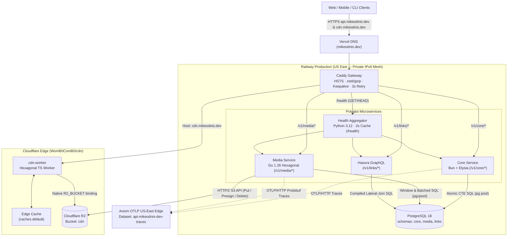
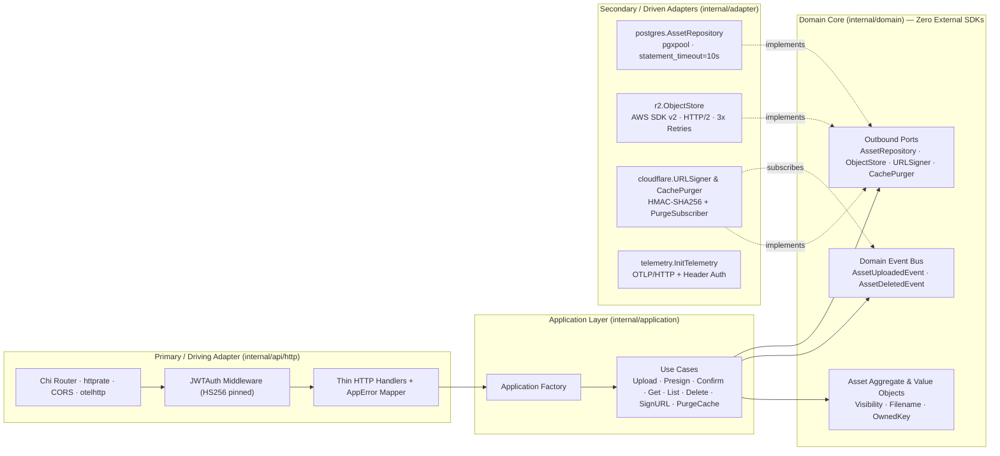
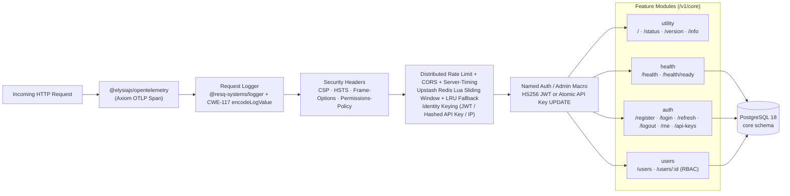
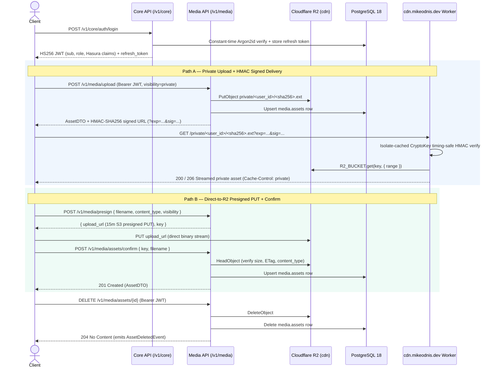
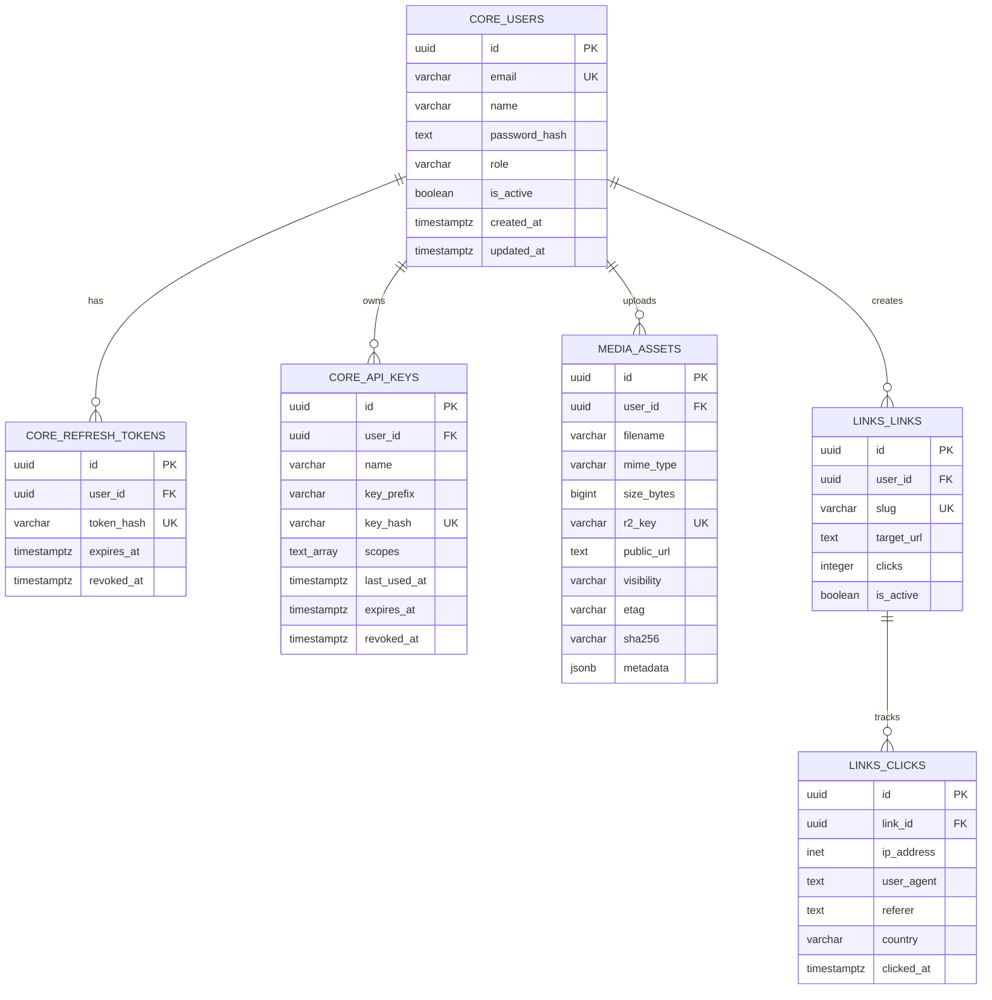
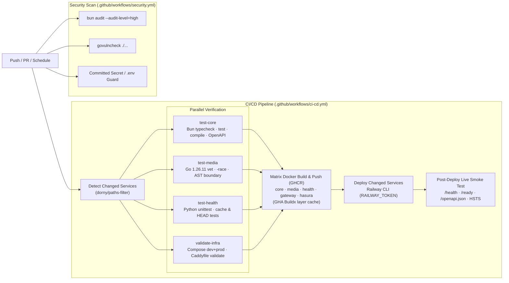

# API Infrastructure — `api.mikeodnis.dev`

[](https://github.com/WomB0ComB0/api/actions/workflows/ci-cd.yml)
[](https://github.com/WomB0ComB0/api/releases)
[](LICENSE)

Production polyglot API platform hosted end-to-end on **Railway (US East)** alongside the Hexagonal Edge CDN [`WomB0ComB0/cdn`](https://github.com/WomB0ComB0/cdn) (**Cloudflare Workers + R2**), with native **Axiom OpenTelemetry** distributed tracing, **distributed sliding-window rate limiting**, and `zizmor`-audited CI/CD & SemVer releases.

| Service | Route | Runtime & Stack | Key Capabilities |
| :--- | :--- | :--- | :--- |
| **Gateway** | `api.mikeodnis.dev` & `cdn.mikeodnis.dev` | **Caddy 2.9** | TLS termination, `zstd`/`gzip`, HSTS preload, Permissions-Policy, CORP, upstream keepalive pools (`64`/`32`), `3s` rolling-restart retry (`lb_try_duration`), static **Live Console** portal (`/`), unified **Scalar OpenAPI Docs** (`/docs`), **LLM/AEO & RFC 9116 discovery** (`/llms.txt`, `/llms-full.txt`, `/.well-known/security.txt`, `/robots.txt`, `/sitemap.xml`), and **Wolf-Mark icons + OpenGraph cards** |
| **Core Service** | `/v1/core/*` | **Bun 1.4 + Elysia** + [`@resq-systems/*`](https://github.com/resq-software/npm) | Feature modules, named auth/admin macros, Argon2id + HS256 Hasura JWTs, 1-CTE refresh rotation, scoped `mk_live_*` API keys, **distributed Upstash Redis Lua + local fallback sliding-window rate limiter** (identity-keyed + IETF `RateLimit-*` headers), CWE-117 log sanitization, Trojan Source bidi protection, OpenAPI 3.1 + Scalar UI, Eden Treaty |
| **Media Service** | `/v1/media/*` | **Go 1.26.11 (Hexagonal + DDD)** | `chi/v5`, `pgx/v5`, AWS S3 SDK v2 (HTTP/2 + retries), Cloudflare R2 (`assets/` & `private/`), **outer IP + post-JWT per-user cost-tiered sliding-window rate limiter**, HMAC-SHA256 private CDN signing, presigned direct PUTs, domain event bus, AST boundary enforcement |
| **Links Service** | `/v1/links/*` | **Hasura GraphQL Engine** | Baked v3 metadata (`cli-migrations-v3`), JWT role/row permissions, `limit: 100` caps, production allow-list, single-query lateral-join compilation |
| **Health Aggregator** | `/health` | **Python 3.12 (stdlib)** | Zero-dependency dual-stack IPv6/IPv4 server, shared thread pool, 2s coalesced probe cache (anti-thundering-herd), `GET`/`HEAD` support, graceful `SIGTERM` |
| **Database** | Internal (`*.railway.internal`) | **PostgreSQL 18** | Multi-schema (`core`, `media`, `links`), auto-idempotent bootstrap, composite pagination indexes |
| **Observability** | US East Edge OTLP | **Axiom (`otel:traces:v1`)** | Direct OTLP/HTTP trace export (`core-service` + `media-service`) via least-privilege ingest token |

---

## System Topology (Production)



---

## Go Media Service — Hexagonal Architecture

`services/media` implements **Ports & Adapters (Hexagonal Architecture) + DDD**, modeled after [`WomB0ComB0/go-hexagonal`](https://github.com/WomB0ComB0/go-hexagonal). Dependencies strictly point **inward** toward the domain core and are enforced automatically on every `go test` run via Go AST inspection in [`services/media/architecture_test.go`](./services/media/architecture_test.go).



---

## Core Service — Elysia Lifecycle & `@resq-systems/*` Integration

`services/core` follows official [ElysiaJS best practices](https://elysiajs.com/essential/best-practice) (feature modules with decoupled `service.ts`, TypeBox `model.ts`, named auth/admin macros, and Eden Treaty inference) powered by [`@resq-systems/*`](https://github.com/resq-software/npm) packages:

- **`@resq-systems/logger`**: Structured JSON logging (`JsonTransport`) in production and colorized logs in dev.
- **`@resq-systems/dsa`**: O(1) bounded `LRUCache` (`maxSize: 10_000`) backing the in-process weighted sliding-window fallback limiter.
- **`@resq-systems/security`**: `generateSecureToken` & `hashData` (`Sha256Hex`) for refresh tokens and API keys, `encodeLogValue` + `sanitizeForLogging` (CWE-117 log/ANSI injection & secret scrubbing), and `containsBidiControls` (CVE-2021-42574 Trojan Source protection).
- **`@resq-systems/types`**: Branded numeric bounds (`toPositiveInt`) and runtime guards (`isNonEmptyString`).



---

## End-to-End Auth, Upload, Presigned PUT & Private CDN Flow



---

## Database Schema (N+1-Free & Indexed)

Every query across `core`, `media`, and `links` executes in **O(1)** database roundtrips:
- **Core**: `register` & `refresh` run as **1 atomic CTE**; API-key auth runs as **1 atomic `UPDATE ... FROM` join**; `users.list` uses **`COUNT(*) OVER()`**; `listApiKeys` is bounded (`LIMIT 100`). Verified by query-count assertions in [`services/core/src/__tests__/app.test.ts`](./services/core/src/__tests__/app.test.ts).
- **Media**: `ListByUser` uses **`COUNT(*) OVER()`** (1 query on `idx_assets_user_created`); `FindByIDs` batches via `WHERE id = ANY($1::uuid[])`. Verified by `TestListAssetsIsNPlusOneFree`.
- **Hasura**: Compiles nested GraphQL queries (`links → clicks`, `links → user`) into a single lateral-join SQL query, capped at `limit: 100` per table permission.



---

## Automated CI/CD & Security Pipeline



Weekly grouped dependency PRs are managed automatically via [`.github/dependabot.yml`](./.github/dependabot.yml) across `bun`, `gomod`, `docker`, and `github-actions`. All workflows are audited with `zizmor` (`0` findings) with 40-char commit SHA pinning and `persist-credentials: false`.

### SemVer Releases (`.github/workflows/release.yml`)

Pushing an annotated SemVer tag (`vX.Y.Z`) or triggering `workflow_dispatch` runs full strict verification (`Bun + Go + Python + Compose/Caddy`), publishes versioned GHCR images for all 5 services (`core`, `media`, `health`, `gateway`, `hasura`), packages `core-openapi-vX.Y.Z.json`, `media-linux-amd64-vX.Y.Z`, and `SHA256SUMS.txt`, and publishes a GitHub Release with categorized notes ([`.github/release.yml`](./.github/release.yml)).

---

## Security, Performance & Reliability Posture

- **Zero known CVEs**: Enforced on every push & weekly via `bun audit --audit-level=high` (`core-service`) and `govulncheck ./...` (`media-service`, Go `1.26.11`), plus `zizmor` GitHub Actions supply-chain hardening.
- **Distributed Rate Limiting (IETF `RateLimit-*` + `Retry-After`)**:
  - `core-service`: Multi-policy router (`auth` `10/60s`, `auth-keys` `20/60s`, `write` `30/60s`, `read` `100/60s`; health/OpenAPI exempt), identity keying via `apikey:<sha256-16>` or verified HS256 JWT `user:<sub>` before IP, atomic 1-RTT Upstash Redis Lua sliding-window counter (`UPSTASH_REDIS_REST_URL`/`TOKEN`, `250ms` timeout + circuit breaker) with automatic bounded in-process weighted sliding-window fallback, and live `rate_limiter` telemetry on `GET /v1/core/status`.
  - `media-service`: Bounded weighted sliding-window limiter with outer IP ceiling (`120/60s`) plus post-JWT per-user cost tiers (`20/60s` on `POST /upload`, `/presign`, `/purge`; `100/60s` on reads/sign/delete; health/OpenAPI exempt).
  - `traefik/dynamic/middlewares.yml`: Tiered `global-ratelimit`, `auth-ratelimit`, and `write-ratelimit` middlewares with CORS `RateLimit-*` header exposure.
- **Authentication & Abuse Prevention**: Argon2id password hashing with constant-time dummy verification on login (prevents email enumeration), HS256 JWT algorithm pinning, atomic refresh-token rotation, Trojan Source bidi rejection (`containsBidiControls`), CWE-117 log/ANSI escaping (`encodeLogValue`), and `1 MiB` request/header caps.
- **Connection & Upstream Resilience**:
  - `core-service`: `pg.Pool` idle error listener (crash-proof on DB restart), `statement_timeout: 10s`, `query_timeout: 12s`, TCP `keepAlive`, `maxUses: 7500`.
  - `media-service`: `pgxpool` `HealthCheckPeriod: 30s`, `MaxConnLifetime: 30m`, `statement_timeout: 10s`, Slowloris `ReadHeaderTimeout: 10s`, HTTP/2 R2 transport with `3x` standard retries.
  - `health-aggregator`: shared thread pool, 2s coalesced cache (prevents probe storms), `GET`/`HEAD` support, graceful `SIGTERM`.
  - `gateway`: Caddy `lb_try_duration 3s` / `lb_try_interval 250ms` (absorbs rolling container restarts), HTTP keepalive pools (`64`/`32`), HSTS preload + security headers.

---

## API Endpoints

### Portal, Interactive Docs, Discovery & Brand Assets (Gateway)
| Method | Path | Auth | Description |
| :--- | :--- | :--- | :--- |
| `GET`/`HEAD` | `/` | Public | Content-negotiated: Live Console HTML portal + live `/health` telemetry + JSON-LD (`WebAPI`, `FAQPage`) for browsers; JSON service descriptor for API/CLI clients |
| `GET` | `/docs` | Public | Unified multi-spec **Scalar OpenAPI 3.1** UI loading both Core API & Media API |
| `GET` | `/llms.txt`, `/llms-full.txt` | Public | Concise and full LLM/AEO guides for AI crawlers & coding agents |
| `GET` | `/.well-known/security.txt`, `/robots.txt`, `/sitemap.xml` | Public | RFC 9116 security policy, explicit AI crawler rules (`GPTBot`, `OAI-SearchBot`, `ClaudeBot`, `PerplexityBot`), XML sitemap |
| `GET` | `/favicon.ico`, `/icon.svg`, `/apple-touch-icon.png` | Public | Live Console Wolf-Mark favicons & Apple Touch icon (`CORP: cross-origin`) |
| `GET` | `/opengraph-image`, `/opengraph-image.png`, `/twitter-image`, `/twitter-image.png` | Public | 1200×630 Live Console OpenGraph & Twitter `summary_large_image` social preview cards (`CORP: cross-origin`) |

### Core Service (`/v1/core`)
| Method | Path | Auth | Description |
| :--- | :--- | :--- | :--- |
| `GET`/`HEAD` | `/v1/core`, `/status`, `/version`, `/info` | Public | Root, runtime memory/uptime, version, metadata |
| `GET`/`HEAD` | `/v1/core/health`, `/v1/core/health/ready` | Public | Liveness & PostgreSQL readiness probes |
| `GET` | `/v1/core/docs`, `/v1/core/openapi.json` | Public | Scalar OpenAPI 3.1 UI & raw JSON spec |
| `POST` | `/v1/core/auth/register` | Public | Create account + issue JWT & refresh token (1 CTE) |
| `POST` | `/v1/core/auth/login` | Public | Constant-time Argon2id verify + issue token pair |
| `POST` | `/v1/core/auth/refresh` | Public | Atomically rotate refresh token (1 CTE) |
| `POST` | `/v1/core/auth/logout` | Public | Revoke refresh token |
| `GET` | `/v1/core/auth/me` | JWT / API Key | Current authenticated user profile |
| `POST`/`GET`/`DELETE` | `/v1/core/auth/api-keys`, `/api-keys/:id` | JWT | Create, list (`LIMIT 100`), and revoke scoped `mk_live_*` keys |
| `GET` | `/v1/core/users` | Admin JWT | Paginated user list with `total` (`COUNT(*) OVER()`) |
| `GET`/`PATCH`/`DELETE` | `/v1/core/users/:id` | Self / Admin | Read, update, or delete user |

### Media Service (`/v1/media`)
| Method | Path | Auth | Description |
| :--- | :--- | :--- | :--- |
| `GET` | `/v1/media/health`, `/health/ready`, `/openapi.json` | Public | Liveness, Postgres+R2 readiness, OpenAPI spec |
| `POST` | `/v1/media/upload` | JWT | Multipart upload to R2 (`assets/` or `private/`) + DB record |
| `POST` | `/v1/media/presign` | JWT | Direct-to-R2 15m presigned PUT URL (blocks HTML/JS MIME) |
| `POST` | `/v1/media/assets/confirm` | JWT | Verify presigned object via `HeadObject` and persist metadata |
| `POST` | `/v1/media/sign` | JWT | Generate HMAC-SHA256 signed `cdn.mikeodnis.dev/private/*` URL |
| `POST` | `/v1/media/purge` | JWT | Purge Cloudflare edge cache (owner-scoped or admin) |
| `GET` | `/v1/media/assets` | JWT | Paginated asset list with `total` (`COUNT(*) OVER()`) |
| `GET`/`DELETE` | `/v1/media/assets/:id` | Owner / Admin | Fetch metadata or delete from R2 + DB + event-driven purge |

### Links Service (`/v1/links`) & Aggregate Health (`/health`)
| Method | Path | Auth | Description |
| :--- | :--- | :--- | :--- |
| `POST` | `/v1/links/v1/graphql` | Anonymous / JWT | Hasura GraphQL endpoint (allow-listed, `limit: 100` capped) |
| `GET` | `/v1/links/healthz` | Public | Hasura health probe |
| `GET`/`HEAD` | `/health` | Public | Coalesced concurrent aggregate health across Core, Media, Hasura |

---

## Quick Start & Observability

### Prerequisites
- [Bun](https://bun.sh/) `1.4+`, [Go](https://go.dev/) `1.26.11+`, Python `3.12+`
- [Docker](https://docs.docker.com/) + Compose v2 (for local full-stack)

```bash
# 1. Generate local .env with secure random secrets
./setup.sh

# 2. Run all test suites locally
(cd services/core && bun install && bun run typecheck && bun test)
(cd services/media && go vet ./... && go test -race ./...)
(cd services/health && python3 -m unittest discover -v)

# 3. Start full local stack (add --profile observability for local Jaeger :16686)
docker compose up -d --build
```

### Live Observability (Axiom CLI)

```bash
# Query live production OTel traces from core-service and media-service
axiom query "['api-mikeodnis-dev-traces'] | summarize spans=count() by ['service.name']" --start-time="-30m"
axiom query "['api-mikeodnis-dev-traces'] | project _time, ['service.name'], name, duration | limit 20" --start-time="-30m"
```

---

## Documentation
- [Architecture Deep Dive](./docs/ARCHITECTURE.md)
- [Production Deployment Guide](./docs/DEPLOYMENT.md)
- [Quick Reference](./docs/QUICK_REFERENCE.md)

## License

Apache-2.0
