# Architecture Deep-Dive — `api.mikeodnis.dev` & `cdn.mikeodnis.dev`

## 1. High-Level Topology

*Interactive source: [`diagrams/platform-architecture.html`](./diagrams/platform-architecture.html)*

---

## 2. Shared Security & CDN Contract (`api` ↔ `cdn`)

| Shared Primitive | Owner | Consumers | Contract |
| :--- | :--- | :--- | :--- |
| `JWT_SECRET` (HS256, ≥32B) | `core-service` issues | `core-service`, `media-service`, `hasura` | Mandatory `exp` claim; includes `sub`, `email`, `role`, and `https://hasura.io/jwt/claims` |
| `SIGNING_SECRET` (≥32B) | `media-service` signs | `cdn-worker` verifies | `HMAC-SHA256("<path>:<unix_exp>")` as unpadded Base64URL, constant-time verified |
| `GATEWAY_PROXY_SECRET` (32B) | `gateway` (Caddy) injects | `cdn-worker` verifies | Constant-time matched via `X-Gateway-Proxy-Secret` so `X-Gateway-Client-IP` gives per-visitor CDN rate limiting behind Railway |
| Public R2 Prefix | `media-service` writes | `cdn-worker` serves | `assets/<user_id>/<hash><ext>` → `https://cdn.mikeodnis.dev/assets/...` (`immutable`, 1y TTL; SVGs sandboxed with strict CSP) |
| Private R2 Prefix | `media-service` writes | `cdn-worker` serves | `private/<user_id>/<hash><ext>` → `?exp=<ts>&sig=<mac>` (`private, no-store`, `CDN-Cache-Control: no-store`, `Referrer-Policy: no-referrer`, `X-Robots-Tag: noindex, nofollow`) |
| Staging R2 Prefix | `media-service` presigns | **Blocked at CDN** | `staging/<user_id>/...` is non-servable; promoted via ETag-pinned `CopyObject` (`CopySourceIfMatch`) after magic-byte + SVG verification, then deleted |

---

## 3. Edge Gateway Hardening (`services/gateway`)

*Interactive source: [`diagrams/security-trust-boundaries.html`](./diagrams/security-trust-boundaries.html)*

- **Strict Client IP Extraction:** Caddy 2.11 configures `trusted_proxies_strict` so downstream services extract client IPs right-to-left without trusting spoofed `X-Forwarded-For` prefixes.
- **Fail-Closed Hasura Allowlist:** Only `/v1/links/graphql`, `/v1/links/v1/graphql`, and `/v1/links/healthz` are proxied; `X-Hasura-Admin-Secret` and `X-Hasura-Access-Key` are stripped at ingress; GraphQL payloads are capped at `256KB`; admin/metadata/console endpoints (`/v1/metadata`, `/v1/query`, `/v2/query`, `/console`, `/v1/version`) are blocked.
- **Per-Visitor CDN Isolation:** When `cdn.mikeodnis.dev` routes through Caddy, the gateway forwards `X-Gateway-Proxy-Secret` and `X-Gateway-Client-IP` so each visitor gets an isolated Cloudflare rate-limit bucket (seamlessly falling back to `CF-Connecting-IP` when proxied directly by Cloudflare).

---

## 4. Go Media Service — Hexagonal Layer Rules

Enforced automatically by [architecture_test.go](file:///home/wombocombo/github/prs/api/services/media/architecture_test.go):

| Layer | Path | Allowed Internal Imports | Forbidden Imports |
| :--- | :--- | :--- | :--- |
| **Domain** | `internal/domain/**` | `domain/**`, `pkg/apperr` | `application`, `adapter`, `api`, `pgx`, `aws-sdk-go-v2`, `chi`, `net/http` |
| **Application** | `internal/application/**` | `domain/**`, `application/**`, `pkg/apperr` | `adapter`, `api`, `pgx`, `aws-sdk-go-v2`, `chi` |
| **Primary Adapter (API)** | `internal/api/**` | `application/**`, `domain/**`, `config`, `pkg/apperr` | `adapter`, `pgx`, `aws-sdk-go-v2` |
| **Secondary Adapters** | `internal/adapter/**` | `domain/**`, `config`, `pkg/apperr` | `api` |
| **Composition Root** | `cmd/server/main.go` | All layers (wires DI + event bus) | — |

*Interactive source: [`diagrams/media-hexagonal-layers.html`](./diagrams/media-hexagonal-layers.html)*

Key security invariants in Media Service:
- 513-byte UTF-8 sniff sentinel + magic-byte validation + active-content SVG sanitization on both direct uploads and staged confirms.
- Strict `ValidateObjectKeySafety` on `SignURL` (`private/*` only) and `ConfirmUpload` (`staging/<user_id>/*` only).
- 2-second coalesced `/health/ready` probe cache, `nosniff` + `no-store` error parity, and `DELETE /assets/{id}` enforced under the `20/min` write tier.

---

## 5. Core Service — Elysia Best Practices

- **Feature Modules:** `src/modules/{utility,health,auth,users}` separate `model.ts` (TypeBox `t` schemas + `UnwrapSchema`), `service.ts` (pure business logic decoupled from Elysia `Context`), and `index.ts` (Elysia controller).
- **Macros & Auth:** Named, scoped macros (`auth: true`, `admin: true`) in `src/plugins/auth.ts` enforce mandatory JWT `exp`, `read`-scope enforcement on API keys, and JWT-only mutations/admin access.
- **Security Headers & Rate Limits:** Global `onRequest` security headers + `Cache-Control: no-store` on all `2xx`/`4xx`/`5xx`, distributed Upstash Redis rate limiting with dual IP + API-key buckets, and 2-second coalesced `/health/ready`.
- **Production Binary:** Built with `bun install --frozen-lockfile` and `bun build --compile --minify-whitespace --minify-syntax --target bun --external pg`.

---

## 6. N+1-Free Query Architecture

| Operation | Service | Query Pattern | DB Roundtrips |
| :--- | :--- | :--- | :---: |
| Register user + refresh token | Core | Single atomic CTE (`WITH created_user, created_token`) | **1** |
| Refresh token rotation | Core | Single atomic CTE (`WITH revoked, inserted`) — race-free | **1** |
| API key authentication | Core | Single atomic `UPDATE core.api_keys ... FROM core.users ... RETURNING` | **1** |
| List users (paginated + total) | Core | Single `SELECT ..., COUNT(*) OVER()` using `idx_users_created_at` | **1** |
| List API keys | Core | Single `SELECT` using partial index `idx_api_keys_user_active` | **1** |
| List media assets (paginated + total) | Media | Single `SELECT ..., COUNT(*) OVER()` using `idx_assets_user_created` (`offset <= 10000`) | **1** |
| Batch lookup media assets | Media | Single `SELECT ... WHERE id = ANY($1::uuid[])` | **1** |
| Links & click analytics | Hasura | Single compiled lateral-join SQL query using `idx_links_user_created` & `idx_clicks_link_clicked` | **1** |
