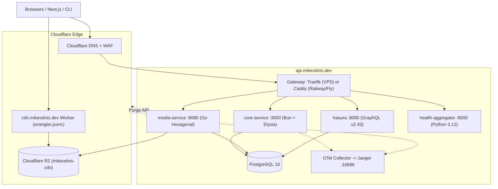
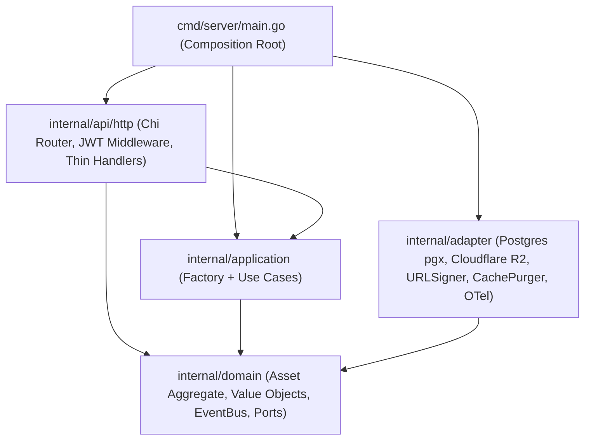

# Architecture Deep-Dive — `api.mikeodnis.dev` & `cdn.mikeodnis.dev`

## 1. High-Level Topology

---

## 2. Shared Security & CDN Contract (`api` ↔ `cdn`)

| Shared Primitive | Owner | Consumers | Contract |
| :--- | :--- | :--- | :--- |
| `JWT_SECRET` (HS256, ≥32B) | `core-service` issues | `core-service`, `media-service`, `hasura` | JWT contains `sub`, `email`, `role`, and `https://hasura.io/jwt/claims` |
| `SIGNING_SECRET` (≥32B) | `media-service` signs | `cdn-worker` verifies | `HMAC-SHA256("<path>:<unix_exp>")` encoded as unpadded Base64URL, compared in constant time |
| Public R2 Prefix | `media-service` writes | `cdn-worker` serves | Key `assets/<user_id>/<hash><ext>` → `https://cdn.mikeodnis.dev/assets/...` (`immutable`, 1y TTL) |
| Private R2 Prefix | `media-service` writes | `cdn-worker` serves | Key `private/<user_id>/<hash><ext>` → `https://cdn.mikeodnis.dev/private/...?exp=<ts>&sig=<mac>` (`private`, 1h TTL) |

---

## 3. Go Media Service — Hexagonal Layer Rules

Enforced automatically by [architecture_test.go](file:///home/wombocombo/github/prs/api/services/media/architecture_test.go):

| Layer | Path | Allowed Internal Imports | Forbidden Imports |
| :--- | :--- | :--- | :--- |
| **Domain** | `internal/domain/**` | `domain/**`, `pkg/apperr` | `application`, `adapter`, `api`, `pgx`, `aws-sdk-go-v2`, `chi`, `net/http` |
| **Application** | `internal/application/**` | `domain/**`, `application/**`, `pkg/apperr` | `adapter`, `api`, `pgx`, `aws-sdk-go-v2`, `chi` |
| **Primary Adapter (API)** | `internal/api/**` | `application/**`, `domain/**`, `config`, `pkg/apperr` | `adapter`, `pgx`, `aws-sdk-go-v2` |
| **Secondary Adapters** | `internal/adapter/**` | `domain/**`, `config`, `pkg/apperr` | `api` |
| **Composition Root** | `cmd/server/main.go` | All layers (wires DI + event bus) | — |

---

## 4. Core Service — Elysia Best Practices

- **Feature Modules**: `src/modules/{utility,health,auth,users}` each separate `model.ts` (TypeBox `t` schemas + `UnwrapSchema`), `service.ts` (pure business logic decoupled from Elysia `Context`), and `index.ts` (Elysia controller).
- **Macros**: Named, scoped macros (`auth: true`, `admin: true`) in `src/plugins/auth.ts` eliminate repetitive guard checks and propagate non-null `authUser` types and OpenAPI security requirements automatically.
- **Typed Responses**: Every route uses `return status(code, payload)` with explicit response schemas for end-to-end **Eden Treaty** (`@elysiajs/eden`) type safety and OpenAPI 3.1 generation.
- **Production Binary**: Built via `bun build --compile --minify-whitespace --minify-syntax --target bun --external pg` (retaining function names for OpenTelemetry spans and keeping `pg` external for DB auto-instrumentation).

---

## 5. N+1-Free Query Architecture

| Operation | Service | Query Pattern | DB Roundtrips |
| :--- | :--- | :--- | :---: |
| Register user + refresh token | Core | Single atomic CTE (`WITH created_user, created_token`) | **1** |
| Refresh token rotation | Core | Single atomic CTE (`WITH revoked, inserted`) — race-free | **1** |
| API key authentication | Core | Single atomic `UPDATE core.api_keys ... FROM core.users ... RETURNING` | **1** |
| List users (paginated + total) | Core | Single `SELECT ..., COUNT(*) OVER()` using `idx_users_created_at` | **1** |
| List API keys | Core | Single `SELECT` using partial index `idx_api_keys_user_active` | **1** |
| List media assets (paginated + total) | Media | Single `SELECT ..., COUNT(*) OVER()` using `idx_assets_user_created` | **1** |
| Batch lookup media assets | Media | Single `SELECT ... WHERE id = ANY($1::uuid[])` | **1** |
| Links & click analytics | Hasura | Single compiled lateral-join SQL query using `idx_links_user_created` & `idx_clicks_link_clicked` | **1** |
